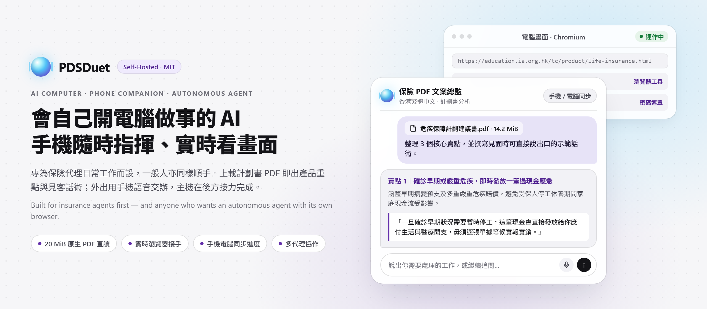
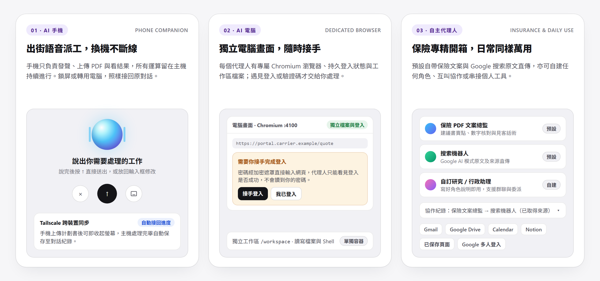

<div align="center">

<picture>
  <source media="(prefers-color-scheme: dark)" srcset="assets/banner-dark.png">
  <source media="(prefers-color-scheme: light)" srcset="assets/banner.png">
  
</picture>

<br>

### 一部會自己開電腦做事、手機隨時接手的自主 AI 代理人

An autonomous AI agent with its own computer — built for insurance brokers first, simple enough for anyone to run daily.

<p>
  <a href="#繁體中文介紹"><strong>繁體中文</strong></a> ·
  <a href="#english"><strong>English</strong></a> ·
  <a href="#快速部署--quick-start">快速部署 / Quick Start</a> ·
  <a href="#架構與安全設計--architecture">架構與規格 / Architecture</a>
</p>

<p>
  
  
  
  
</p>

</div>

<br>

<div align="center">
<picture>
  <source media="(prefers-color-scheme: dark)" srcset="assets/showcase-dark.png">
  <source media="(prefers-color-scheme: light)" srcset="assets/showcase.png">
  
</picture>
<br>
<sub>出街手機語音派工 · 瀏覽器畫面隨時接手 · 保險專精開箱亦支援自建角色與團隊共用</sub>
</div>

---

<a id="繁體中文介紹"></a>

## 繁體中文介紹

### 為甚麼寫 PDSDuet？

保險從業員日常最花精神的，往往不是專業判斷，而是**趕著見客前，要把幾十頁保司計劃書拆成客人聽得明的重點與講法**；或者在外出途中，臨時要查公開條款、對數字、整理跟進草稿。

一般對話式 AI 每次換裝置都要重頭交代、開不了真實網頁查原文，手機一鎖屏長任務就斷。**PDSDuet** 把主機上的 **AI 電腦**、口袋裡的**手機網頁伴侶**與可分工的**自主代理人**放進同一個工作台：你在外面用手機講一句或丟入計劃書 PDF，主機在後方繼續跑；回到電腦前打開同一個畫面，進度、檔案和瀏覽器登入狀態都在。

---

### 三個核心能力

<table>
<tr>
<td width="33.3%" valign="top">

#### 📱 AI 手機 · 隨身指揮不斷線
- **手機電腦同一條對話**：經 Tailscale 安全連回主機，外出一半交辦的任務，回公司用電腦直接接著看。
- **全螢幕語音輸入**：行街坐車不方便打字時，按一下麥克風口述需求，說完直接送出或放回編輯框微調。
- **鎖屏照樣繼續跑**：所有運算與串流狀態由主機 PostgreSQL 管理，切出畫面或斷線重連後自動恢復進度。

</td>
<td width="33.3%" valign="top">

#### 🖥️ AI 電腦 · 看得見、接得手
- **每個代理人一台電腦**：自帶獨立 Chromium 瀏覽器（保留網站登入狀態）及隔離工作區 `/workspace`。
- **實時瀏覽器畫面**：對話旁邊隨時展開「電腦畫面」，清楚看見代理人正在看哪一頁、點了哪裡。
- **安全接手登入**：遇到需要輸入密碼或驗證碼的網站，代理人會停下來交棒給你；密碼透過加密遮罩直接輸入網頁，代理人永不接觸密碼。

</td>
<td width="33.3%" valign="top">

#### 🤝 自主代理人 · 保險專精、日常萬用
- **開箱即用雙代理人**：內建「保險 PDF 文案總監」與「搜索機器人」，不用自己從零寫設定。
- **Bot 之間直接協作**：主代理人可主動委派其他代理人查資料，過程收起為可展開的協作紀錄，最後統一整理交回給你。
- **自建角色與群聊**：隨時新增任何專長的新代理人，亦可開一個群聊讓多個代理人同場各自回應。

</td>
</tr>
</table>

---

### 保險從業者的 5 分鐘日常

1. **選取代理人，直接丟入 PDF 原檔**
   在手機或電腦打開對話，上載保司產品小冊子或建議書（單檔最高 **20 MiB**，單輪總附件上限 **32 MiB**）。系統會將原始 PDF 直接傳給模型閱讀頁面與數字，而不是粗糙抽取純文字。
2. **取得可直接見客的香港繁體中文成稿**
   預設的**保險 PDF 文案總監**會依實際文件產出：
   - **產品一句話定位**
   - **3 至 4 個不重複的核心賣點**（由客戶實際財務痛點切入到具體保障或回報數字）
   - **可直接說出口的示範話術**（得體自然的香港書面繁體中文，不寫空洞口號，亦不在結尾追問客套話）
   - **2 條客戶常見問題與正面解答**
3. **要查保監局、稅務或醫療公開資料，直接交給搜索機器人**
   **搜索機器人**會用瀏覽器固定分頁開啟 Google AI 模式查詢，把完整回答與來源連結原文直傳給你，不做擅自改寫或刪節。
4. **遇到需要登入保司系統或網頁查核，點一下接手**
   展開右側「電腦畫面」，自己輸入帳號密碼完成驗證後按「我已登入」，代理人就會接著完成餘下步驟。

---

### 普通人也能拿來做甚麼？

你不做保險，一樣可以把 PDSDuet 當成自己的「隨身 AI 電腦」：

- **自建專職小助手**：新增代理人時只需寫清楚名稱與職責說明（支援直接調用 OpenAI / Anthropic，或接駁你自己的 AG-UI / LangGraph 服務），就能變成旅遊比價、租約／條款核對、技術研究或書信寫作助手。
- **瀏覽器＋工作區雙管齊下**：讓它替你打開網頁讀資料、用 Shell 處理文字或整理筆記寫入 `/workspace`，也可以把整理好的報告存成**已保存頁面**隨時重溫。
- **按意願串接個人工具**：在「應用程式連接」授權接上 **Gmail、Google Drive、Google Calendar 或 Notion**，寄信等外部動作由你親自批核。
- **自己用，或跟家人／團隊共用一台主機**：支援 Google、Microsoft、Okta 帳號登入，沿用管理員與一般用戶權限，各人對話與授權分開管理；亦支援單人模式本機啟動。

---

<a id="english"></a>

## English

**PDSDuet** is a self-hosted AI workstation where each agent has its own browser, workspace, and persistent session — steered from either your desktop or your phone. It ships ready for **Hong Kong insurance agents** preparing client meetings, and stays clean and general enough for everyday research and personal workflows.

### Why it feels different from a standard chat box

| Pillar | What actually happens |
| --- | --- |
| **AI Computer** | Each Bot runs with its own Chromium profile, persistent sign-in state, shell, and `/workspace`. Open **Live Screen** beside the chat to watch it browse, or take over when a portal asks for login or 2FA — passwords typed into the masked prompt go straight to the page and never enter the model's transcript. |
| **Phone Companion** | Open the web UI on your phone over Tailscale, attach a proposal PDF, or dictate a task with the full-screen voice sheet. Work continues on the host even if you lock your phone; reconnecting restores the live stream and completed transcript. |
| **Autonomous Agents** | Ships with two default Bots in [agents.yaml](openbot/examples/openduet/agents.yaml): **保險 PDF 文案總監** (turns uploaded insurance PDFs into grounded Hong Kong Traditional Chinese selling points, spoken-ready scripts, and client Q&A) and **搜索機器人** (fetches verbatim Google AI Mode answers with source links). Add custom Bots, let Bots delegate to each other (`message_bot`), run group chats, or save outputs as readable pages. |

### Built for insurance brokers, open to everyday workflows

- **For insurance agents:** Drop in a product brochure or benefit illustration PDF (up to **20 MiB** per file; sent to the model as an original PDF rather than naive text scraping) and walk into your client meeting with verified figures, plain-language positioning, scripts, and objection answers.
- **For everyday users:** Replace or add any Bot role with a plain description. Use it as a personal web researcher that keeps its own browser tabs, saves curated pages, works inside `/workspace`, or connects to your **Gmail, Google Drive, Google Calendar, and Notion** under explicit per-user consent.
- **For solo or small teams:** Run single-user on your own machine, or enable **Google / Microsoft / Okta** sign-in so teammates share one self-hosted server and model key while keeping their own conversations and app grants separate.

---

<a id="快速部署--quick-start"></a>

## 快速部署 / Quick Start

### 1. 環境需求 / Prerequisites

- **Docker**（含 Docker Compose）
- **Bun** `1.3+`
- `openssl`、`curl`、`lsof`
- 你自己的模型 API Key（例如 `OPENAI_API_KEY` 或 `ANTHROPIC_API_KEY`）

### 2. 安裝與啟動 / Configure & Run

```sh
git clone https://github.com/personadynamics-studio/PDSDuet.git
cd PDSDuet
cp openbot/.env.example openbot/.env
```

編輯 `openbot/.env`，至少填入你的模型金鑰（例如 `OPENAI_API_KEY`），再啟動完整服務（Edit `openbot/.env` with your model key, then start the stack）：

```sh
bun install
bash scripts/start.sh
```

啟動完成後打開瀏覽器（Once running, open in your browser）：
- **Web 介面 / App**：`http://localhost:3010`
- **API 服務 / Server**：`http://localhost:3001`

停止服務（加上 `--keep-computers` 可保留各代理人的瀏覽器登入狀態 / pass `--keep-computers` to preserve browser logins）：

```sh
bash scripts/stop.sh --keep-computers
```

### 3. 手機安全接入與多人登入 / Phone Access & Multi-User Sign-In (Tailscale + OAuth)

`openbot/.env.example` 預設啟用 `OPENBOT_SINGLE_USER=true`，僅在本機位址（`127.0.0.1` / `::1`）監聽，方便單機試用。若要從手機經 Tailscale 連線，或開放給團隊以 Google / Microsoft / Okta 登入（Remove `OPENBOT_SINGLE_USER` before exposing beyond localhost）：

1. 從 `openbot/.env` 移除 `OPENBOT_SINGLE_USER=true`。
2. 產生正式金鑰並設定 `KEY_ENCRYPTION_KEY` 與 `BETTER_AUTH_SECRET`（各 32 bytes：`openssl rand -base64 32`）。
3. 設定 OAuth Provider（如 `GOOGLE_OAUTH_CLIENT_ID`、`GOOGLE_OAUTH_CLIENT_SECRET`、`INITIAL_ADMIN_EMAILS`）及 `BETTER_AUTH_URL`、`OPENBOT_PUBLIC_URL`、`TRUSTED_ORIGINS`。
4. 參考 [scripts/tailscale-serve.json](scripts/tailscale-serve.json) 將 Tailscale HTTPS 流量轉發至 `http://127.0.0.1:3010`。

---

<a id="架構與安全設計--architecture"></a>

## 架構與安全設計 / Architecture & Specs

| 層面 Area | 實際規格 Implementation |
| --- | --- |
| **前端介面 Web App** | React、TypeScript、TanStack Router / Query，香港繁體中文介面，支援深淺色模式、手機語音輸入與 SSE 斷線續傳。 |
| **執行與結算 Core Runtime** | Bun + 本地 PostgreSQL；聊天、群聊與 Bot 委派共用單一執行入口與結算模組（[architecture.md](openbot/docs/architecture.md)）。 |
| **AI 電腦 Browser & Files** | Playwright + Chromium 沙盒電腦，支援每 Bot 獨立容器（`supervisor`）或共用容器分資料夾隔離，含實時螢幕與接手控制。 |
| **檔案與上下文 Limits** | 單檔上傳上限 **20 MiB**（PDF 原檔送交模型；Markdown / 純文字保存全文並傳送前 120,000 字元），單輪附件上限 **32 MiB**；非 PDF 內容採 `o200k_base` 300,000 tokens 應用層預算。 |
| **私密與公開邊界 Privacy** | 公開倉庫僅含程式碼、文件及兩個預設角色定義（[agents.yaml](openbot/examples/openduet/agents.yaml)）；API 金鑰、OAuth 憑證、瀏覽器設定檔、客戶計劃書及對話資料均保留在你的本地部署環境。 |

> [!NOTE]
> **目前核心版本說明（2026-11-14）**：目前抽離後的核心整合了對話、瀏覽器操作、原檔 PDF 閱讀、Bot 委派協作與群聊於同一執行迴圈；舊版背景排程（Routines / Morning Brief）及外部執行佇列已移除，不提供自動每日排程執行。詳細架構與運作紀錄請見 [openbot/docs/architecture.md](openbot/docs/architecture.md)。

### 延伸閱讀 / Documentation

- [架構說明 Architecture](openbot/docs/architecture.md) — 執行生命週期、Bot 身份與協作隔離、瀏覽器接手與 SSE 機制
- [部署指南 Deployment](openbot/docs/deployment.md) — 容器映像、嵌入式與外部 PostgreSQL、記憶體建議與暫存清理
- [設定參考 Configuration](openbot/docs/configuration.md) — 環境變數與租戶 YAML 套件設定
- [代理人設定 Coworkers](openbot/docs/coworkers.md) — 角色描述、頻道、可見性與外部 AG-UI 註冊
- [文件總覽 Docs Index](openbot/docs/README.md) — 包含 Google Workspace、Google Drive、Notion 與研究工具說明

---

## 版權與來源 / Attribution & Licence

PDSDuet 基於 [CopilotKit/OpenDuet](https://github.com/CopilotKit/OpenDuet) 與 OpenBot 演進並獨立維護，保留原有版權聲明與 [MIT Licence](LICENSE)。
