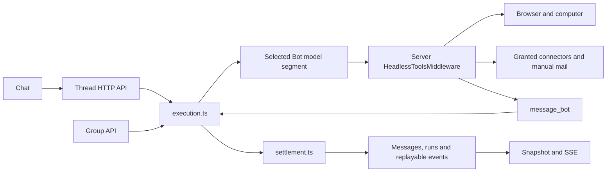

# Browser and Bot execution core

This describes the current browser and Bot execution sources. Historical build and operation results belong in `tasks/todo.md`; source publication alone does not establish runtime success.

## Execution and settlement

The signed-in person explicitly selects a Bot from the same visible profile roster used by Bot collaboration. Chat, group replies and Bot delegation share one execution owner and one transcript writer.

The runtime has four modules:

| Module | Responsibility |
| --- | --- |
| `server/src/runtime/types.ts` | Execution input, outcome, persisted run and writer contracts. |
| `server/src/runtime/execution.ts` | `start`, `run`, `stop` and `close`; actual SDK/tool resources, cancellation and group phases. |
| `server/src/runtime/settlement.ts` | Conversation access, input persistence, output projection, waiting/terminal state and event replay. |
| `server/src/runtime/routes.ts` | Authenticated HTTP parsing, snapshots, SSE and explicit Stop. |

`start` returns the admitted run ID; `run` waits for that same execution. Group targets are phases of one root run. Real child executions carry `parentRunId`. One in-process map owns actual live promises and abort controllers. There is no worker queue, claim, lease renewal, occupancy owner or separate completion ledger.

`server/src/index.ts` assembles the selected model and all application tools once per phase. `toolkit/src/headless-tools.ts` owns server execution of browser, Bot, connector, mail, host and component tools. Native and LangGraph adapters produce model segments and tool-call batches; they do not call a second `/api/agent-tools/call` executor. Unknown, unoffered calls fail rather than silently finish.

The Helm API Deployment has one replica and uses `Recreate`. Horizontal scaling and overlapping API owners are not supported by this execution model. An update therefore interrupts API availability while the process changes.

## Bots, authors and model history

The left menu lists visible profiles and switches to their conversations. With no selected Bot, the UI asks the person to select or create one. New native Bots require a real role description; remote Bots require an explicit endpoint. No stock Bot or automatic introduction is selected as a fallback.

`agents/bot-tools.ts` supplies `list_bots`, `message_bot` and `ask_person`. Visibility comes from `profiles.list(actor)`. Real account visibility, connector grants and filesystem containment remain at their owning boundaries.

`message_bot` invokes a child through the same executor and thread. Child records keep their real authors but are not inserted as separate public chat replies. The outer Bot owns the user-facing answer and incorporates the child's result. Its normal tool record appears as a collapsed collaboration badge; expanding it shows the requester, recipient, task, result and outcome. This works in either direction, without special Bot names. A child awaiting human input leaves the parent waiting; completing the leaf supplies the exact parent tool result and resumes the existing parent run.

`local_messages` is the canonical conversation record. `senderBotId`, `senderUserId` and `createdAt` describe real authors and time. A delegated task has a final model-only `bot_request` carrier with its requester derived from the actual parent run and its recipient from the child phase. Platform instructions identify the Bot and distinguish that current task from earlier human conversation. Peer task text remains request data, never a system instruction or a fabricated human transcript row. Public snapshots expose root records; a model additionally reads its own private run, not unrelated child runs. Groups check membership and keep ordinary replies public without creating work items.

`historyForBot` adapts canonical history for the selected Bot and quotes foreign Bot records as data. `mergeContinuationHistory` keeps tool-call/result pairs adjacent for model input. Neither rewrites the saved transcript. Model state is stored per run and Bot in `local_runs.model_states`, so a group phase or child cannot replace another Bot's state.

Before each native or remote model segment, `agents/model-context.ts` applies a 300,000-token application budget using the `o200k_base` tokenizer. Instructions, tool definitions and non-PDF message content share that budget. The newest complete turns that fit are sent; older turns are omitted without summaries or compression. System instructions remain, and a current turn that cannot fit fails explicitly. This local count includes serialized message structure and an allowance per message; it is not a provider billing count, particularly for images and non-OpenAI models. PDF source bytes/URLs are excluded from this application budget but remain subject to the provider's own limits.

Only the current user message's attachments are loaded and sent, including during that turn's tool continuations. Earlier messages retain their text and an attachment-omitted note, without loading or resending their files. Stored messages and downloadable attachments are unchanged.

## Waiting, Stop and reconnect

Waiting retains the actual tool call ID and tool-specific metadata. Person questions, browser takeover and private input are answered through the thread API. Settlement resolves the recorded waiting leaf and its owner; the currently selected UI Bot does not choose the recipient. Resume keeps the same run ID and completes unexecuted siblings in the original tool batch before another model segment. There is no full continuation snapshot alongside history.

Stop aborts actual live resources before waiting on database cancellation. It follows the real parent family and records stop intent so later group phases cannot start. Waiting or orphaned runs can be closed directly; live tools finish their cancellation before their execution settles. Already submitted atomic mouse/keyboard input cannot be undone, and arbitrary synchronous page JavaScript has no hard cancellation API.

Settlement saves human input and its transcript events in one transaction. Streamed output is saved through the same writer. Final output, waiting/terminal status and the terminal event commit together. Model or storage failures are not reported as successful delivery. Screens, notifications, recording and acknowledgements are not prerequisites for settlement.

Raw SQL binds serialized JSON through `::text::jsonb`. Bun otherwise encodes a string bound directly as JSONB as a JSON string, leaving messages and events in the wrong shape. Consumers read one normal object/array representation. See [Bun's JSON parameter rules](https://bun.com/docs/runtime/sql#sql-json).

Public snapshots read root messages, the event cursor and the root's actual run/waiting state together. Child model output and model-state snapshots stay internal; root tool records remain inspectable through their disclosures. Necessary human questions use the real waiting leaf call ID. A content-free root update refreshes waiting state when a child resumes or waits again. SSE filters child events before pagination, replays public events after `Last-Event-ID`, and follows PostgreSQL notifications. Both the API and frontend proxy disable the thread stream's idle timeout. An initial SSE comment opens the connection immediately; a single cleaned-up 15-second keepalive keeps it open without database polling. Closing a view does not cancel execution; explicit Stop does. Browser screen reconnection uses its native WebSocket independently.

## Browser and computer

`agent-computer` owns Playwright/Chromium and the native persistent profile. Browser-owned restore state preserves sessions; application cookie JSON copies and restore timers have been removed. This source change does not delete profile, cookie or workspace data.

The live screen is bound to an authenticated, visible Bot. Opening it does not wait for recording or a screenshot database write. Taking control cancels the in-flight Bot action and blocks new Bot input, producing a real waiting tool. Release or private input answers that saved call through the common execution flow.

Cancellation reaches provider lookup, HTTP and supported Playwright operations. It preserves the page/profile rather than closing the browser to imitate cancellation. Profile and workspace operations retain containment and Bot isolation at the filesystem owner. SPIRE interception, browser eviction quotas and automatic recording are no longer on this path.

## Startup and retained capabilities

HTTP requests and computer WebSocket upgrades share the same session-to-person resolver. People stores the effective role policy: addresses in `INITIAL_ADMIN_EMAILS` are protected administrators; other people use their stored `user_roles` assignments. Resumed runs and shared-account decisions use that same person projection. Reading a role never rewrites its assignments, and changing a stored role takes effect on the next request without a new login. With no identity provider, the existing single-user `DEV_ACTOR` remains the administrator. This consolidation does not change the existing route admission policy.

`server/schema.sql` owns the complete fresh database schema, including `local_threads`, `local_runs`, `local_messages`, `local_events` and `thread_channel_mappings`. The existing explicit `server/scripts/initialize.ts` step applies it to an empty database in one transaction; existing databases are left unchanged. Normal API startup does not create or alter tables, convert historical JSON, copy legacy group messages or rebuild old sidebar previews.

`index.ts` calls `settlement.recoverInterruptedRuns()` for runs left `pending` or `running` by the previous API process. It records their real `interrupted` outcome and terminal events, with thread notifications in the same transaction. Waiting records and their tool IDs remain available to the existing resume flow. This relies on the documented single API owner. Older databases missing current runtime columns, or still holding JSON strings or legacy-only conversation records, need an explicit data-upgrade decision; startup no longer attempts those conversions and this source change performs none.

Manual mail/calendar, granted connectors, uploaded documents, saved pages, settings and genuine shared-account consent remain. The old routine/scheduling engine, Task intake, proactive research, Responsibility, generic approvals, delivery routing and their workers are not assembled. No working daily-schedule capability is claimed by this extraction.

On 2026-11-14, the API and existing frontend started after importing `MessageSchema` from `@ag-ui/core/schemas`. An actual conversation then exposed the JSON binding issue above and a stopped remote LangGraph service at the insurance Bot's configured endpoint. After repairing the bindings/data and loading that service's current image with its existing model settings, the insurance Bot returned a complete Traditional Chinese answer through the application. The prior frontend build was reused; the LangGraph image was rebuilt. Browser/computer actions, Bot delegation and schedule operation were not exercised by this conversation.

In the subsequent user-authorized browser/PDF operation, the two remaining stock profiles were deleted through Bot management, leaving the insurance Bot. Its private role was updated to permit the existing browser tools and document-reading requests while preserving the insurance copywriting instructions. It navigated to the Insurance Authority's public life-insurance page and returned its title and product categories. An uploaded PDF initially failed because composer cleanup read attachment metadata at the old location and deleted the staged upload. The composer now reads IDs from `attachment.source.metadata` for both reconciliation and release, and reserves text-truncation warnings for actual text files. After rebuilding and loading the frontend, the Bot read the original uploaded PDF and answered questions about specific pages. Attachment access rules were not weakened. Bot delegation and group operation remain unexercised by these operations.
