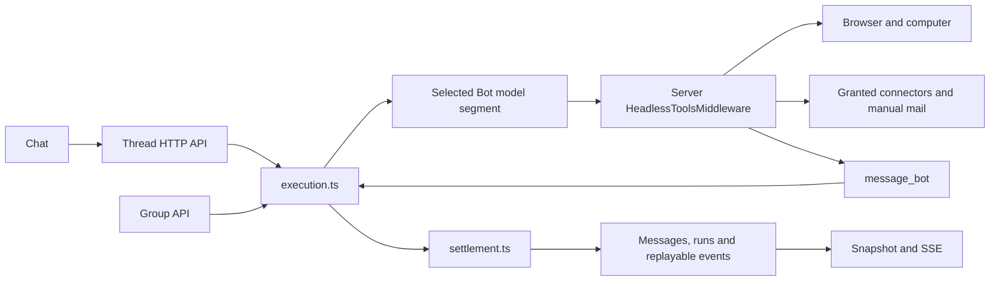

# Browser and Bot execution core

This describes the source extraction of 2026-11-14. Build and operation results belong in `tasks/todo.md`; source publication alone does not establish runtime success.

## Execution and settlement

The signed-in person explicitly selects a Bot from the same visible profile roster used by Bot collaboration. Chat, group replies and Bot delegation share one execution owner and one transcript writer.

The runtime has four modules:

| Module | Responsibility |
| --- | --- |
| `server/src/runtime/types.ts` | Execution input, outcome, persisted run and writer contracts. |
| `server/src/runtime/execution.ts` | `start`, `run`, `stop` and `close`; actual SDK/tool resources, cancellation and group phases. |
| `server/src/runtime/settlement.ts` | Conversation access, input persistence, output projection, waiting/terminal state and event replay. |
| `server/src/runtime/routes.ts` | Authenticated HTTP parsing, snapshots, SSE and explicit Stop. |

`start` returns the admitted run ID; `run` waits for that same execution. Group targets are phases of one root run. Real child executions carry `parentRunId`. One in-process map owns actual live promises and abort controllers. There is no worker queue, claim, lease renewal, occupancy owner or separate completion ledger.

`server/src/index.ts` assembles the selected model and all application tools once per phase. `toolkit/src/headless-tools.ts` owns server execution of browser, Bot, connector, mail, host and component tools. Native and LangGraph adapters produce model segments and tool-call batches; they do not call a second `/api/agent-tools/call` executor. Unknown, unoffered calls fail rather than silently finish.

The Helm API Deployment has one replica and uses `Recreate`. Horizontal scaling and overlapping API owners are not supported by this execution model. An update therefore interrupts API availability while the process changes.

## Bots, authors and model history

The left menu lists visible profiles and switches to their conversations. With no selected Bot, the UI asks the person to select or create one. New native Bots require a real role description; remote Bots require an explicit endpoint. No stock Bot or automatic introduction is selected as a fallback.

`agents/bot-tools.ts` supplies `list_bots`, `message_bot` and `ask_person`. Visibility comes from `profiles.list(actor)`. Real account visibility, connector grants and filesystem containment remain at their owning boundaries.

`message_bot` invokes a child through the same executor and thread. Replies retain their actual `senderBotId`; the caller receives the real child result without another delivery or relay model call. A child awaiting human input leaves the parent waiting on that child. Completing the leaf supplies the original parent tool result and resumes the parent under its existing run ID.

`local_messages` is the canonical transcript. `senderBotId`, `senderUserId` and `createdAt` describe real authors and time. Delegation instructions are model input, not fabricated human messages. Groups check membership and use this same thread; ordinary replies do not create work items.

`historyForBot` adapts canonical history for the selected Bot and quotes foreign Bot records as data. `mergeContinuationHistory` keeps tool-call/result pairs adjacent for model input. Neither rewrites the saved transcript. Model state is stored per run and Bot in `local_runs.model_states`, so a group phase or child cannot replace another Bot's state.

## Waiting, Stop and reconnect

Waiting retains the actual tool call ID and tool-specific metadata. Person questions, browser takeover and private input are answered through the thread API. Settlement resolves the recorded waiting leaf and its owner; the currently selected UI Bot does not choose the recipient. Resume keeps the same run ID and completes unexecuted siblings in the original tool batch before another model segment. There is no full continuation snapshot alongside history.

Stop aborts actual live resources before waiting on database cancellation. It follows the real parent family and records stop intent so later group phases cannot start. Waiting or orphaned runs can be closed directly; live tools finish their cancellation before their execution settles. Already submitted atomic mouse/keyboard input cannot be undone, and arbitrary synchronous page JavaScript has no hard cancellation API.

Settlement saves human input and its transcript events in one transaction. Streamed output is saved through the same writer. Final output, waiting/terminal status and the terminal event commit together. Model or storage failures are not reported as successful delivery. Screens, notifications, recording and acknowledgements are not prerequisites for settlement.

Snapshots read canonical messages, the event cursor and actual run/waiting state together. SSE replays persisted events after `Last-Event-ID` and follows PostgreSQL notifications. Closing a view does not cancel execution; explicit Stop does. Browser screen reconnection uses its native WebSocket independently of thread SSE.

## Browser and computer

`agent-computer` owns Playwright/Chromium and the native persistent profile. Browser-owned restore state preserves sessions; application cookie JSON copies and restore timers have been removed. This source change does not delete profile, cookie or workspace data.

The live screen is bound to an authenticated, visible Bot. Opening it does not wait for recording or a screenshot database write. Taking control cancels the in-flight Bot action and blocks new Bot input, producing a real waiting tool. Release or private input answers that saved call through the common execution flow.

Cancellation reaches provider lookup, HTTP and supported Playwright operations. It preserves the page/profile rather than closing the browser to imitate cancellation. Profile and workspace operations retain containment and Bot isolation at the filesystem owner. SPIRE interception, browser eviction quotas and automatic recording are no longer on this path.

## Startup and retained capabilities

`settlement.initialize()` creates or updates the canonical runtime tables. It retires unfinished runs belonging to the removed executor as interrupted, removes obsolete lease/executor columns, and copies historical public group messages with original IDs and recorded authors. Historical group storage is not a second live transcript. New-runtime waiting records survive a process restart; runs left executing by a dead process become interrupted instead of being automatically replayed.

Manual mail/calendar, granted connectors, uploaded documents, saved pages, settings and genuine shared-account consent remain. The old routine/scheduling engine, Task intake, proactive research, Responsibility, generic approvals, delivery routing and their workers are not assembled. No working daily-schedule capability is claimed by this extraction.

Existing tests and checker files have not been changed. Test suites, lint and type checking are excluded from this delivery. Builds and actual operation are limited to the two rounds authorized by the user; any failed build or startup consumes its round.

Both rounds have now been used. The first frontend build found a stale `seedMessage` import, which was removed. In the second round the frontend, computer image and supervisor image built successfully, but the host API failed to resolve `@ai-sdk/openai` from `toolkit/src/native-agent.ts`. The package is declared in the toolkit manifest and lockfile. No dependency installation or third startup was attempted; no real conversation was reached. The PostgreSQL and supervisor started for this attempt were stopped.
