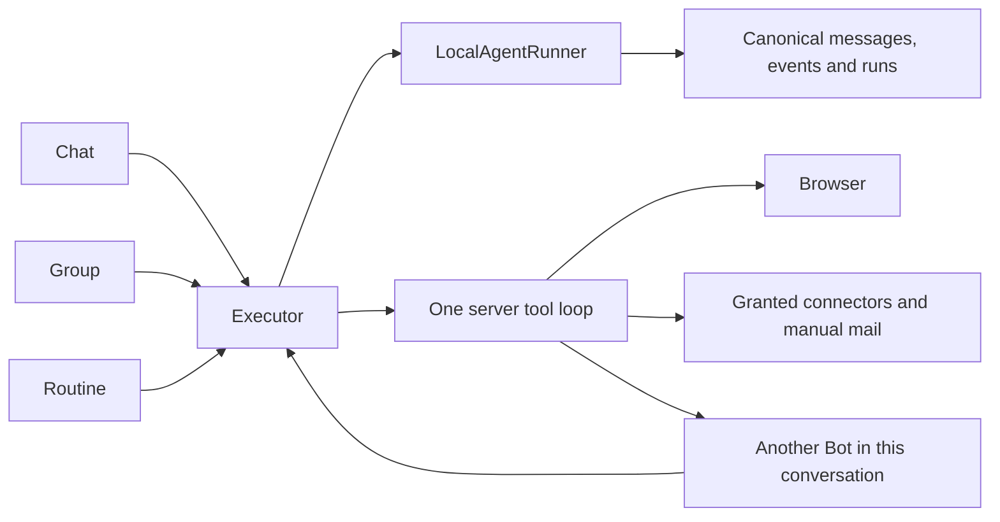

# Browser and Bot execution core

This describes the source extraction of 2026-11-14. It has not been built, loaded or exercised. Source and Git publication do not establish runtime success.

## One execution owner

The signed-in person selects a Bot from the same visible profile roster used by Bot collaboration. Chat, groups and independent schedules enter the same executor.

`toolkit/src/run-turn.ts` builds the Bot and tools once. `start` returns its run/event source; `run` waits on that same execution. `toolkit/src/headless-tools.ts` executes application tools on the server, including browser, Bot, connector, mail, host and component tools. Mixed calls do not get split between a browser observer and a background worker.

`server/src/runtime/local-runner.ts` owns execution and cleanup. `thread-store.ts` owns messages, events, run state and conversation occupancy. The root holds the conversation once; children use real parent ancestry. Only the occupancy owner renews it. Expired execution is recorded as interrupted.

## Bots and groups

`agents/bot-tools.ts` supplies `list_bots`, `message_bot` and `ask_person`. Visibility comes from `profiles.list(actor)`. Pairwise Bot grants and numeric handoff depth/fan-out gates have been removed; account visibility and genuine connector grants remain.

`message_bot` directly invokes a child through the same executor and thread. Its output carries its own `senderBotId`; the caller is not asked to generate a relay of an already saved answer. An active ancestor cannot synchronously delegate back into itself.

`local_messages` is the runtime transcript. `senderBotId`, `senderUserId` and `createdAt` describe real authors and time. Internal delegation instructions are model input, not human messages.

Groups check channel membership and read one canonical thread. Ordinary group replies do not create `group.turn` or `bot.message` work items. The initializer copies historical `group_messages` using original IDs and `ON CONFLICT DO NOTHING`; that table is not a second live transcript. The initializer has not been executed.

`historyForBot` is the sole model-input adapter. It pairs a Bot's own calls/results and quotes foreign Bot records as data. It leaves the saved transcript intact. A formal human answer preserves the unanswered siblings of that exact tool batch so the tool owner finishes them before asking the model again.

## Stop, waiting and reconnect

Stop follows the real parent family, cancels running descendants and closes waiting calls. It leaves stop intent on completed phases so later group replies cannot start in the gap between phases. Completed output retains its actual status.

Waiting records the actual tool call ID and tool-specific metadata. Person questions, browser takeover and private field input resume through the thread API. The response resolves the saved leaf Bot/run by call ID rather than guessing from the selected Bot. It uses canonical messages and state, not a second continuation snapshot.

Human inputs and tool answers are saved with transcript events in the same transaction. Output is persisted before completion; terminal run state and its event are committed together. Snapshots return messages, event cursor and real run/waiting state. SSE uses database notifications and `Last-Event-ID`.

Authenticated remote callbacks must belong to a running, non-stopped run. Callback I/O consumes both HTTP cancellation and that run's stop notification. A signed identity does not authorize a completed run to continue acting.

Closing a screen or leaving an SSE view does not cancel execution. Explicit Stop does.

## Browser and computer

`agent-computer` owns Playwright/Chromium and the native persistent profile. `--restore-last-session` uses browser-owned state; application cookie JSON copies and restore timers have been removed. No user profile, cookie or workspace data was deleted by executing this change.

The screen is a live WebSocket view bound to an authenticated, visible Bot. Opening it does not wait for demonstration recording or a screenshot database write.

The existing control holder owns input. Taking control cancels the in-flight Bot action and blocks new Bot input. That condition becomes a real waiting tool. Release or private input answers the same saved call, without a Responsibility or approval worker.

Cancellation is passed through provider lookup, HTTP and the supported Playwright operations. Already submitted atomic mouse/keyboard input cannot be undone; arbitrary synchronous page JavaScript has no hard cancellation API. The implementation preserves the browser session rather than closing its page to imitate cancellation.

Profiles and workspace operations keep containment and Bot isolation at the filesystem owner. Fleet listings use the visible profile roster. SPIRE attestation, Web Bot Auth interception, browser eviction quotas and automatic recording have been removed from this path.

## Independent features and delivery boundary

Manual mail/calendar, other granted connectors, saved pages, account settings and genuine shared-account consent remain. Ordinary routines use the same executor and consume actual waiting/stopped outcomes.

Proactive research, Task intake, Responsibility, automatic follow-ups, delivery routing, generic approval review/inbox and their worker loops are not assembled by the core. `createApp(config, services)` names API dependencies instead of passing a long positional list. Optional broker errors are reported for that connector and do not terminate browser startup.

No tests, test assets, lint, type checking, builds, services, SQL, browser operations or actual conversations were executed for this extraction. Existing test/checker files remain untouched. Runtime operation count is still 0 of the previously allowed 2 rounds.
